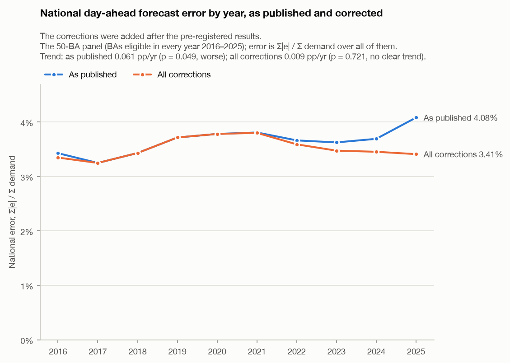

# Grid forecast audit: day-ahead demand forecasts in EIA-930, 2016–2025

Are US grid operators' day-ahead demand forecasts getting worse? There's no robust sign of it. In
EIA-930, the standard public source of hourly US grid data, national error rises slightly, but
the median across regions shows no clear trend and most pre-registered checks don't confirm the
rise. Three problems in EIA-930 explain it: the California ISO's demand runs an hour late for
about four of the ten years, it includes battery charging that its forecast leaves out, and the
Southwest Power Pool forecast stops matching the operator's own in May 2025. With them corrected,
in checks added after the pre-registered results, the trend is flat. Anyone using EIA-930
inherits these problems.



*National error (total absolute error over total demand) on the 50-BA panel, the BAs eligible
in every year 2016–2025, as published in EIA-930 and with all three corrections. Values:
[national_by_year.csv](results/figures/national_by_year.csv).*

## Key findings

*BA*: balancing authority, the operator that balances supply and demand in its area. *MAPE*:
mean absolute percentage error against actual demand. *National*: total absolute error over
total demand, either on the **50-BA panel** (BAs eligible in every year, used for trends) or
over **all 53 BAs** eligible in 2025. *Naive forecast*: demand 24 hours earlier; *skill* below
0 means a BA's forecast loses to it. *pp/yr*: percentage points per year. *CISO*, *SWPP*:
EIA's codes for the California ISO and Southwest Power Pool; *CAISO* and *SPP* mean the
operators' own data.

- **As published, the national trend is weak and fragile; corrected, it is flat.** On the
  50-BA panel, national error rises 0.061 pp/yr (Mann–Kendall p = 0.049, "worse"). The median
  across the panel's BAs shows no clear trend (0.010 pp/yr, p = 0.474), and three of the five
  pre-registered robustness variants turn the national verdict to no clear trend (p = 0.074 to
  0.107). With all three corrections, the 50-BA national trend is 0.009 pp/yr (p = 0.721), and
  2025 falls from the worst of the ten years to 6th-worst on the panel median and 8th-worst on
  the national figure. Individual BAs move both ways. Each of the 52 BAs with at least 8
  eligible years was tested on its own yearly MAPE: 11 are worse (MAPE rising, Mann–Kendall
  p < 0.05) and 10 better (falling, p < 0.05) as published, and 10 and 10 with all corrections.
  By chance alone, about 2.6 of the 52 would reach p < 0.05.
- **CISO's demand runs an hour late for about four of the ten years:** from at least
  2016-01-01, where the check against CAISO's data begins, to 2016-09-12, and from 2022-06-14 to
  2025-12-02 except 2022-06-15 (Pacific days); earlier months were not checked. EIA's CISO
  forecast equals CAISO's own day-ahead forecast in every checked month, while EIA's CISO demand
  matches CAISO's actual load an hour earlier: on 333 of 334 days from 2025-01-01 to 2025-12-02
  (mean gap 0.62% moved, 3.25% as published) and on 514 of 515 checked days inside the spans,
  while 454 of 458 checked days outside them are on time. The correction starts on 2016-01-01
  because the audit years do.
- **EIA-930's SWPP forecast stops matching SPP's own from 2025-05-07.** Before that date,
  EIA's SWPP forecast was within 2% of SPP's own day-ahead forecast on 122 of 125 days; from
  7 May to 31 December it was more than 2% away on 219 of 238 days, at 1.11–1.14 times SPP's by
  monthly median, while EIA's SWPP demand kept matching SPP's actual load (monthly medians
  0.998–1.004). On the same 2025 hours, each against its own source's load, SPP's own forecast
  scores MAPE 1.71% (skill 0.58); the series in EIA-930 scores 7.79%, with a bias of 6.41%
  (over-forecast). Why it changed is not visible in the files.
- **CISO's demand counts battery charging; its forecast does not.** CISO reports its batteries
  under EIA-930's "Other Fuel Sources" (its "Battery Storage" column is blank): against CAISO's
  own 2025 battery output, that column matches at correlation 0.999 once moved back an hour.
  CAISO removed battery charging from its forecast system's inputs in June 2021
  ([CAISO, 22 June 2021, slide 44](https://www.caiso.com/documents/presentation-marketperformance-planningforum-jun222021.pdf)),
  and EIA's instructions say charging belongs in net generation, not demand
  ([EIA-930 instructions](https://www.eia.gov/survey/form/eia_930/instructions.pdf)); both are
  quoted in [results/ciso_check.md](results/ciso_check.md). In 2025 CAISO's forecast gap
  follows charging almost MW for MW (b = 0.90, R² = 0.91); against actual load less charging,
  CAISO's bias goes from −6.9% to −0.6% and its MAPE from 7.31% to 2.45%. With all three
  corrections, CISO's 2025 MAPE in the audit falls from 8.28% to 2.35% and its skill rises from
  −0.78 to 0.56.
- **Where accuracy stands.** In 2025 the median MAPE across the 53 eligible BAs is 4.16%, and the
  national figure over all 53 is 4.24% (3.58% with all corrections). 19 of the 53 lose to the
  naive forecast (17 with all corrections: CISO and SWPP stop losing). Over 2016–2025, forecasts
  miss most on holidays (Thanksgiving: median ratio 1.24 against comparable days) and on winter
  peak-demand days (1.18), and the change in error from 2019 to 2025 is unrelated to demand
  growth (Spearman ρ = −0.004, p = 0.978, 49 BAs).

Full results: [results/audit.md](results/audit.md). Operator checks:
[results/operator_check.md](results/operator_check.md) and
[results/ciso_check.md](results/ciso_check.md).

## Method

### Data

- **Source:** EIA-930, EIA's Hourly Electric Grid Monitor: all 22 six-month BALANCE files from
  <https://www.eia.gov/electricity/gridmonitor/sixMonthFiles/>, July 2015 to June 2026, 6,135,530
  BA-hours from 72 BAs. EIA revises these files in place, so each file's size, download time and
  SHA-256 are recorded in [results/schema_check.md](results/schema_check.md).
- **Truth and forecast:** the truth is raw reported demand; the forecast is the day-ahead
  forecast as published, and only impossible forecast values (≤ 0) are dropped.
- **Scope:** local years 2016–2025 (2015 and 2026 are half-years). A BA-year is eligible when at
  least 50% of its hours are usable: 53 BAs in 2025, a 50-BA panel eligible in every year (all 10
  largest BAs included), and 49 BAs for the demand-growth question. 4,582,331 hours are scored.
- **Metrics,** with error e = forecast − demand: MAPE (primary), WAPE, bias, and skill =
  1 − MAPE / naive MAPE on the same hours. Summaries are the median across BAs and one national
  figure, Σ|e| / Σ demand. The median resists a few broken series; the national figure does not,
  because it weights BAs by demand, and CISO's and SWPP's broken series moved it: on the 50-BA
  panel its trend is 0.061 pp/yr as published and 0.009 pp/yr with all corrections.
- **Questions:** Q1, accuracy in 2025; Q2, the trend (Theil–Sen slope, two-sided Mann–Kendall
  test); Q3, when forecasts miss (season and hour, holidays, 19 extreme-weather events chosen by
  a stated rule, extreme-demand days); Q4, demand growth against change in error; Q5, who loses
  to the naive forecast, and why, for the 10 largest BAs.

### Data-quality rules

Applied in this order ([results/data_quality.md](results/data_quality.md)):

| Rule | Drops | Hours removed after the rules above |
| :-- | :-- | --: |
| R1 | Demand or forecast ≤ 0 | 15,939 |
| R2 (N = 6) | Hours repeating the previous hour's demand inside a run of at least 6 equal hours | 4,808 |
| R3a | A BA's hours within 7 days of its start, stop or footprint change ([data/ba_events.csv](data/ba_events.csv)) | 2,330 |
| R4 | Hours where EIA changed the reported demand | 513 |
| R5 | Demand more than 10% (and 1 MW) away from net generation minus interchange, except in exempted episodes | 72,899 |
| R3b | Every hour of a BA with fewer than 8,760 usable hours | 1,021 |

5,038,714 hours stay usable, 98.1% of the 5,136,224 hours with both demand and a forecast.

**No rule uses forecast error.** Forecast error is what the audit measures: a rule that dropped
hours where forecast and demand disagree would remove real forecast failures along with bad data,
and bias the audit toward accuracy. The rules use only demand, net generation, interchange, EIA's
own imputation flags and documented BA events. R5's exception rule works the same way: for a
mismatch lasting more than 30 days, if demand stayed within ±10% of the same months a year
earlier while net generation or interchange shifted by more than 10% of demand, the mismatch is
blamed on those series and the demand is kept (93 of 171 episodes;
[data/balance_exemptions.csv](data/balance_exemptions.csv)). Thresholds were not moved after
seeing whom they affect: CISO's 2019–2020 episode, with a net-generation shift of −9.6%, stays
under R5, and the run without R5 covers it.

### Pre-registration and later changes

The audit plan, [docs/step3_audit_plan.md](docs/step3_audit_plan.md) (metrics, questions, event
list and its selection rule, figures and robustness variants), was committed in `edd06df` on
2026-10-28 at 17:18 −04:00, before any forecast error was computed. The same commit fixed a design
flaw in R5's exception rule, also before any forecast error existed: daily episodes could not see
a mismatch confined to the same hours of each day, so hour-of-day episodes were added. The plan
and the rule code are unchanged since:

```sh
git diff edd06df -- docs/step3_audit_plan.md src/grid_audit/quality.py \
  src/grid_audit/quality_rules.py src/grid_audit/truth.py src/grid_audit/data_quality.py
```

It should print nothing.

Later changes, by commit date:

| Committed | Commit | Change |
| :-- | :-- | :-- |
| 2026-10-28 | `a61ece2` | The audit, computed as planned. Choices where the plan is silent are listed under Notes in `results/audit.md`. |
| 2026-10-30 | `b0412db` | The national panel trend shown for every robustness variant, because the main run's "worse" verdict rests on p = 0.049, with the ranks of 2024 and 2025. Q3 marks Winter Storm Uri and the hurricanes, when outages cut demand. Operator data for CISO and SWPP, the plan's Q5 step 2. |
| 2026-10-30 | `b59cc86` | CISO's late demand dated back to 2016 against CAISO's data; the "Verified corrections" variant; every event with documented load shedding marked, with sources in [data/load_shedding.csv](data/load_shedding.csv). |
| 2026-11-01 | `09e45e6` | CISO's "Other Fuel Sources" verified as its batteries; the "CISO without charging" and "All corrections" variants; the exploratory battery check. |

None of these changed a rule, a threshold, the event list or any number in the main run; they
added variants, checks and caveats. The headline figure was added with this README and draws on
the main run and the All corrections variant.

### Operator cross-checks

The plan's Q5 step 2 compares the largest BAs that lose to the naive forecast with the
operator's own published load and day-ahead forecast. That meant CISO (2023–2025), SWPP (2025)
and FPL (2016–2017); for FPL, no public archive of hourly forecasts was found.

- **CAISO OASIS:** CAISO's day-ahead load forecast and actual load, for 2025 and January–June
  2026, plus sample months from 2016 to 2024 to date CISO's late demand (64 files).
- **CAISO Today's Outlook:** CAISO's own battery output for every day of 2025 (365 files).
- **SPP Marketplace:** SPP's mid-term load forecast against actual load, one file per issue hour,
  for 2025 (389 files). SPP's day-ahead forecast for a day is taken as the 03:00 issue of the day
  before, the issue EIA-930's SWPP forecast matched on 2025-01-02.

All are public and needed no account. Every file's URL, size, download time and SHA-256 is in
[results/operator_files.csv](results/operator_files.csv). EIA's series are lined up against the
operator's at shifts of whole hours, day by day. CISO's late spans were set by the correlation
of hour-to-hour changes, which a level difference cannot fake. The checks never change the main
run: their corrections enter only the robustness variants.

## Robustness

Each variant re-runs the whole audit with one change and re-applies every rule; eligibility and
the panel are recomputed. The main run and the next five variants were pre-registered; the last
three were added after the results. "National 2025" is over all 53 BAs eligible in 2025 in every
variant. The national trend and the ranks are on the panel: 50 BAs, or 51 without R5. Ranks place
2025 among the ten panel years, 1 being the highest error.

| Variant | Pre-registered | Median 2025 MAPE (%) | National 2025 WAPE, 53 BAs (%) | National panel trend, pp/yr (p, verdict) | Rank of 2025, panel median / national | BAs worse / better | BAs losing to naive, 2025 |
| :-- | :-- | --: | --: | :-- | --: | --: | --: |
| Main | yes | 4.16 | 4.24 | 0.061 (0.049, worse) | 1 / 1 | 11 / 10 | 19 |
| EIA adjusted demand | yes | 4.16 | 4.23 | 0.062 (0.074, no clear trend) | 1 / 1 | 10 / 9 | 19 |
| Without R5 | yes | 4.16 | 4.24 | 0.052 (0.107, no clear trend) | 1 / 1 | 11 / 10 | 19 |
| R2 with N = 3 | yes | 4.16 | 4.24 | 0.061 (0.049, worse) | 1 / 1 | 11 / 9 | 19 |
| R2 with N = 12 | yes | 4.16 | 4.24 | 0.061 (0.049, worse) | 1 / 1 | 11 / 10 | 19 |
| Repeated forecasts dropped | yes | 4.16 | 4.23 | 0.061 (0.074, no clear trend) | 1 / 1 | 11 / 10 | 19 |
| Verified corrections | no | 4.11 | 3.80 | 0.032 (0.210, no clear trend) | 2 / 4 | 11 / 10 | 18 |
| CISO without charging | no | 4.16 | 4.04 | 0.035 (0.107, no clear trend) | 1 / 1 | 10 / 10 | 18 |
| All corrections | no | 3.93 | 3.58 | 0.009 (0.721, no clear trend) | 6 / 8 | 10 / 10 | 17 |

The three corrections:

- **CISO's late demand:** moved back one hour in the late spans from 2016-01-01, the start of the
  audit years: 36,533 hours.
- **SWPP's forecast:** replaced by SPP's own day-ahead forecast for the local days 2025-05-07 to
  2025-12-31: 5,737 hours.
- **CISO's charging:** taken out of its demand from July 2018, when EIA-930 starts reporting fuel
  types (mean 1,485 MW in 2025). Hours with no battery value keep demand as published.

"Verified corrections" applies the first two, "CISO without charging" the third, and "All
corrections" all three. The full table, with the panel-median slope, Q4's correlation and the
variants' counts, is under Robustness in [results/audit.md](results/audit.md).

## Limitations

- **The corrections were added after the results.** The three corrections were added after the
  pre-registered results had been computed and reviewed, and the main run stays as published.
  Each correction was verified by comparing EIA-930 with the operator's own series, not by its
  effect on forecast error, though Q5's forecast-shift check first pointed at CISO's timing.
- **The search for problems was one-sided.** Only BAs whose forecasts looked bad were checked
  against operator data: the largest BAs that lose to the naive forecast. So the problems found
  tend to lower errors when corrected, mostly in recent years, which tilts the corrected trend
  down. A problem that made a forecast look better than it is would not have been found.
- **Exploratory:** the check of whether any other BA's forecast gap tracks battery charging
  ([results/battery_check.md](results/battery_check.md)) is not in the plan. None does.
- **Open: SWPP's change on 7 May 2025.** Its cause is unknown; what changed in the forecast
  EIA-930 carries for SWPP is not visible in the files, and only EIA or SPP could say. The
  stand-in, SPP's 03:00 issue of the day before, is a choice: before 7 May EIA's SWPP forecast
  followed it closely but was rarely identical to it.
- **Not settled:** the corrections assume CISO's battery column runs late together with its demand
  in every late span. That is verified for 2025 only; before 2025 the evidence is indirect, and it
  points to on time in June–July 2022 and July 2023, where the choice moves CISO's MAPE by at most
  0.15 pp. About 377 MW in every hour of CAISO's 2025 gap stays unexplained; non-dispatchable pump
  load is a candidate, untested.
- **Scope:** only CISO and SWPP were checked against operator data. With all corrections, 17 BAs
  still lose to the naive forecast in 2025, none of them among the 10 largest, and none checked.
  When each BA issues its forecast is not known, so the naive forecast may use demand not yet
  known at issue time, which makes it a demanding benchmark.
- **Caveats in the results:** during Winter Storm Uri and the hurricanes, outages and load
  shedding cut actual demand, so those event "errors" mostly measure electricity that could not
  be delivered (marked † in `results/audit.md`). CHPD (2016-01 to 2021-06) and TEPC (2018-10 to
  2019-05) published forecasts inconsistent with their demand; they stay in, marked ‡.
- **Snapshot:** EIA revises its files in place. The results are for the files hashed in
  [results/schema_check.md](results/schema_check.md); a fresh download may differ.

## Reproduce

Python 3.11 and [uv](https://docs.astral.sh/uv/). Run the commands in this order. Downloads go
one at a time into `data/raw/` and skip files already there; the tests never touch the network.

```sh
uv sync
uv run python -m grid_audit.download_history    # the 22 EIA-930 BALANCE files
uv run python -m grid_audit.data_check          # results/data_check.md (go/no-go, Jan–Jun 2026)
uv run python -m grid_audit.build_history       # data/processed/balance.parquet, results/schema_check.md
uv run python -m grid_audit.quality_rules       # results/quality_rules_proposal.md
uv run python -m grid_audit.truth_check         # results/demand_truth.md
uv run python -m grid_audit.data_quality        # results/data_quality.md, data/balance_exemptions.csv
uv run python -m grid_audit.download_operators  # CAISO and SPP files, into data/raw/operators/
uv run python -m grid_audit.audit               # results/audit.md, results/figures/
uv run python -m grid_audit.operator_check      # results/operator_check.md, results/operator_files.csv
uv run python -m grid_audit.ciso_check          # results/ciso_check.md
uv run python -m grid_audit.battery_check       # results/battery_check.md (exploratory)
uv run pytest -q
```

The audit reads the cached SPP files for its corrections, so `download_operators` comes before
it. Code layout and data rules: [CONTRIBUTING.md](CONTRIBUTING.md).
